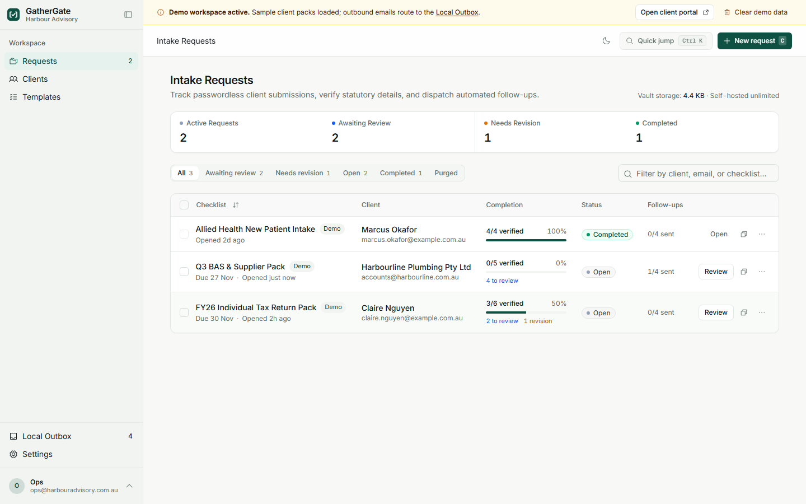

<div align="center">


<br />

Self-hosted, open-source alternative to Content Snare and FileInvite. Collect client documents via passwordless magic links with deterministic validation, AES-256-GCM encryption, and keyboard-first review in one container.

<p>
  <a href="#quickstart"></a>&nbsp;&nbsp;<a href="#product-tour"><picture><source media="(prefers-color-scheme: dark)" srcset=".github/assets/cta-tour-dark.svg" /><source media="(prefers-color-scheme: light)" srcset=".github/assets/cta-tour-light.svg" /></picture></a>&nbsp;&nbsp;<a href="SECURITY.md"><picture><source media="(prefers-color-scheme: dark)" srcset=".github/assets/cta-security-dark.svg" /><source media="(prefers-color-scheme: light)" srcset=".github/assets/cta-security-light.svg" /></picture></a>
</p>

<p>
  <a href="https://github.com/FAAS19/gathergate/actions/workflows/ci.yml"></a>
  <a href="CHANGELOG.md"></a>
  <a href="LICENSE"></a>
  <a href="SECURITY.md"></a>
  <a href="package.json">= 22.13" /></a>
  <a href="Dockerfile"></a>
  <a href=".github/workflows/ci.yml"></a>
</p>

<p>
  <a href="https://gathergate.tensorforge.dev/demo/#/"><strong>Live Demo</strong></a> &middot;
  <a href="https://gathergate.tensorforge.dev/docs/"><strong>Docs</strong></a> &middot;
  <a href="https://gathergate.tensorforge.dev/">Showcase</a> &middot;
  <a href="https://gathergate.tensorforge.dev/docs/guides/ai-agents/">AI Agents &amp; MCP 2.0</a> &middot;
  <a href="https://gathergate.tensorforge.dev/docs/deployment/one-click-templates/">1-Click Deploy</a> &middot;
  <a href="#validator-packs">Validator Packs</a> &middot;
  <a href="#compare">Compare</a> &middot;
  <a href="CONTRIBUTING.md">Contributing</a>
</p>

</div>

<p align="center">
  
</p>

## Why GatherGate

- **Stop chasing scattered email attachments:** Replace long reply threads and broken shared-drive links with one passwordless magic-link checklist per client.
- **Catch bad tax and bank IDs at submission:** Deterministic checksum validators reject mistyped ABNs, TFNs, UTRs, EINs, IBANs, and routing numbers before your team discovers them weeks later.
- **Keep sensitive documents off third-party SaaS:** Avoid per-seat SaaS pricing and external vendor custody of tax, KYC, and identity files by running everything in one container on your own infrastructure.

## Quickstart

Explore the interactive static demo in your browser at **[gathergate.tensorforge.dev/demo/](https://gathergate.tensorforge.dev/demo/#/)**, or run directly with Node.js (`>= 22.13`):

```bash
npx gathergate
```

Or pull the multi-arch (`linux/amd64`, `linux/arm64`) image with zero `.env` setup on first boot:

```bash
docker run -d \
  --name gathergate \
  -p 127.0.0.1:3080:3080 \
  -v gathergate_data:/data \
  ghcr.io/faas19/gathergate:latest
```

Or boot locally from source with Docker Compose:

```bash
docker compose up -d --build
```

Built-in zero-Docker CLI helpers:

```bash
npx gathergate doctor --url http://127.0.0.1:3080               # Read-only runtime, SQLite & MCP check
npx gathergate setup --client claude-desktop --url http://127.0.0.1:3080  # Generate MCP client config
GATHERGATE_API_KEY=gg_live_... npx gathergate mcp               # Built-in stdio-to-HTTP MCP bridge
```

Or deploy on persistent container hosts with 1-click templates: [Render Blueprint](https://render.com/deploy?repo=https://github.com/FAAS19/gathergate) ([`render.yaml`](render.yaml)), [Coolify](deploy/coolify/docker-compose.yml), [Dokploy](deploy/dokploy/docker-compose.yml), [Railway](deploy/railway/railway.json), [Umbrel](deploy/umbrel/umbrel-app.yml), [CasaOS](deploy/casaos/docker-compose.yml), and [Fly.io](deploy/fly/fly.toml) (see the [1-Click Self-Hosted Deploy Guide](https://gathergate.tensorforge.dev/docs/deployment/one-click-templates/)).

When `MASTER_KEY` is unset, GatherGate generates a 32-byte key at `DATA_DIR/.master.key` and displays a banner until you move `MASTER_KEY` into your environment (see [`.env.example`](.env.example)). Open `http://127.0.0.1:3080` to initialise your workspace.

## Product Tour

**Operator Console** (`J`/`K` row selection and `Enter` to open requests from the console, `Space`/`A`/`R` review triage inside `ReviewSheet`, unified status filters, and automated reminder counters; toggles between dark zinc and Daylight themes and adapts automatically to your GitHub theme):

<picture>
  <source media="(prefers-color-scheme: dark)" srcset=".github/assets/dashboard-dark.png" />
  <source media="(prefers-color-scheme: light)" srcset="site/public/screenshots/operator-dashboard.png" />
  
</picture>

**Inline Decrypted Review (`ReviewSheet`)** (inspect decrypted PDFs, tax invoice scans, and CSV/text files inside a sandboxed drawer with `Space`, approve and advance with `A`, or request revisions with `R`):

<picture>
  <source media="(prefers-color-scheme: dark)" srcset=".github/assets/review-dark.png" />
  <source media="(prefers-color-scheme: light)" srcset="site/public/screenshots/operator-review.png" />
  
</picture>

**Passwordless Client Portal** (white-labelled with your practice colours and logo, automatic debounced saves, optional 6-digit email OTP, N/A notes, and mobile camera capture):


## Architecture & Capabilities

Built on Node.js 24 (`node:sqlite` WAL + `node:crypto`), Hono (5 production dependencies), React 19, `shadcn/ui`, and Tailwind CSS v4 with zero telemetry:

- **Per-record AES-256-GCM vault**: Every uploaded file and sensitive text field derives a unique HKDF-SHA256 subkey from `MASTER_KEY` bound with authenticated additional data (`enc_version = "v1"`).
- **Magic-byte inspection**: Verifies real file signatures (`PDF`, `PNG`, `JPEG`, `WebP`, `DOCX`, `XLSX`, `CSV`, `TXT`) before storage and rejects executables, HTML, SVG uploads, and arbitrary ZIPs.
- **Sandboxed inline previews**: Decrypted previews stream with `Content-Security-Policy: default-src 'none'; sandbox`, `X-Content-Type-Options: nosniff`, and `Referrer-Policy: no-referrer`.
- **Canonical ZIP export, 6 signed webhooks & scoped API keys**: Export consistently named packs (`{client}_{item}_{seq}.{ext}` + `summary.json`), deliver 6 HMAC-SHA256 lifecycle events (`request.opened`, `item.submitted`, `request.in_review`, `request.completed`, `request.overdue`, `request.purged`) backed by a 6-attempt SQLite retry queue (5 exponential retries) with dead-letter replay, and automate via SHA-256-hashed scoped workspace API keys (`gg_live_...`).
- **Built-in stateless MCP 2.0 server & Agent Skill**: Expose `POST /mcp` (`2026-07-28` + legacy revisions), zero-dependency stdio bridge (`npx gathergate mcp`), Official MCP Registry manifest ([`server.json`](server.json)), and bundled `SEP-2640` skill ([`skills/gathergate/SKILL.md`](skills/gathergate/SKILL.md)) with a strict metadata-only boundary (zero raw IDs, notes, files, or magic tokens in LLM context). See the [AI Agents & MCP 2.0 Guide](https://gathergate.tensorforge.dev/docs/guides/ai-agents/).
- **Scheduled retention auto-purge**: Automatically deletes completed encrypted blobs, erases stored field values, and shreds prior webhook payload rows after your retention window (14 days default for TFN, Medicare, UK NINO, and US SSN packs, 30 days otherwise).

## Validator Packs

Validators live in `src/validators/packs/` and execute deterministically before submissions enter your review queue (unknown validator keys fail closed):

| Pack | Module | Deterministic Rules |
| :--- | :--- | :--- |
| **Generic** | [`src/validators/packs/generic.ts`](src/validators/packs/generic.ts) | `email`, `url`, `phone_e164` (international E.164), `iban` (ISO 13616 mod-97) |
| **Australia** | [`src/validators/packs/au.ts`](src/validators/packs/au.ts) | `au_abn_mod89`, `au_bsb`, `au_tfn_mod11` (masked + audited reveal), `au_medicare_mod10` (masked), `au_phone_e164` |
| **United Kingdom** | [`src/validators/packs/uk.ts`](src/validators/packs/uk.ts) | `uk_utr_mod11` (HMRC 10-digit mod-11), `uk_nino` (masked), `uk_sort_code` (6-digit) |
| **United States** | [`src/validators/packs/us.ts`](src/validators/packs/us.ts) | `us_ein` (IRS prefix + 9-digit), `us_routing_aba` (ABA mod-10), `us_ssn` (SSA rules, masked) |
| **European Union** | [`src/validators/packs/eu.ts`](src/validators/packs/eu.ts) | `eu_vat` (27-country format + BE/DE/FR checksums) |

Adding more regional packs (NZ, CA, SG, JP) requires one module implementing `ValidatorPack`; see [CONTRIBUTING.md](CONTRIBUTING.md).

<a id="compare"></a>

## How GatherGate Compares

| Capability | GatherGate (Self-Hosted) | Content Snare | FileInvite |
| :--- | :--- | :--- | :--- |
| **Pricing** | Free & MIT open source (self-hosted) | Paid monthly request & team tiers | Paid per-seat & enterprise tiers |
| **Data residency & encryption** | Your host or S3 bucket, per-record AES-256-GCM with auto-purge | Vendor-managed SaaS infrastructure | Vendor-managed SaaS infrastructure |
| **Deterministic checksums & magic-bytes** | Built-in mod-89/11/10/97 packs plus binary signature inspection | Basic field formatting & extension rules | Basic field validation & accepted file lists |
| **Automated follow-ups, webhooks & AI agents** | Scheduled chasers, canonical ZIP, 6 signed webhooks with retry queue, scoped API keys & built-in MCP 2.0 | Scheduled reminders & PDF/ZIP exports | Scheduled reminders & portal downloads |
| **Source & lock-in** | Full source on GitHub, portable SQLite & encrypted blobs | Closed-source SaaS | Closed-source SaaS |

## Configuration

<details>
<summary>Storage, Email, Tenancy &amp; Environment Reference</summary>

| Variable | Default | Options / Notes |
| :--- | :--- | :--- |
| `MASTER_KEY` | Auto-generated file | 64-char hex key (32 bytes) for HKDF + AES-256-GCM encryption |
| `STORAGE_BACKEND` | `local` | `local` (`DATA_DIR/blobs`) or `s3` (Cloudflare R2, AWS S3, MinIO, Backblaze B2 via SigV4) |
| `EMAIL_BACKEND` | `console` | `console` (Local Email Outbox + stderr), `smtp` (Nodemailer), or `resend` (Resend HTTP API); also configurable per workspace in `/settings` |
| `MULTI_TENANT` | `false` | `false` for single-workspace unlimited hosting, or `true` with `FREE_MAX_ACTIVE_REQUESTS` and `FREE_MAX_STORAGE_BYTES` |

See [`.env.example`](.env.example) for the complete list of environment variables.

</details>

<details>
<summary>Backup &amp; Restore</summary>

Stop the container so SQLite WAL frames checkpoint cleanly before archiving `gathergate.sqlite` and `blobs/` (keep `MASTER_KEY` in your secret manager, separate from backup archives):

```bash
# Backup (volume name uses <project-dir>_gathergate_data)
docker compose stop gathergate
docker run --rm -v gathergate_gathergate_data:/data -v "$PWD:/backup" alpine \
  sh -c 'cd /data && tar -czf "/backup/gathergate-backup-$(date +%F).tar.gz" gathergate.sqlite $([ -d blobs ] && echo blobs)'
docker compose start gathergate

# Restore
docker compose up --no-start
docker run --rm -v gathergate_gathergate_data:/data -v "$PWD:/backup" alpine \
  sh -c 'tar -xzf /backup/gathergate-backup-YYYY-MM-DD.tar.gz -C /data && chown -R 1000:1000 /data'
docker compose up -d
```

</details>

<details>
<summary>Run Without Docker (Node.js 24+)</summary>

GatherGate runs natively on Node.js >= 22.13 (Node 24+ recommended for built-in `node:sqlite` and `node:crypto.argon2Sync`) with zero native compilation or external database. Run directly via `npx`:

```bash
npx gathergate
```

Or build and run from source:

```bash
git clone https://github.com/FAAS19/gathergate.git && cd gathergate
npm ci
npm --prefix client ci
npm run build
NODE_ENV=production HOST=127.0.0.1 PORT=3080 DATA_DIR=./data npm start
```

Put a reverse proxy (Caddy, Nginx, or Cloudflare Tunnel) in front of `127.0.0.1:3080` and set `TRUST_PROXY=true` and `BASE_URL=https://your-domain` in `.env`.

</details>

<details>
<summary>Local Development &amp; Verification</summary>

Requires Node.js >= 22.13 (Node 24+ recommended for built-in `node:crypto.argon2Sync` and `node:sqlite`):

```bash
npm install
npm --prefix client install
npm run typecheck
npm run build
npm test
npm run test:e2e
```

For hot-reloading UI development, run `npm run dev` (API on `:3080`) and `npm run dev:client` (Vite on `:5173`). To build and test the static showcase site and `VITE_DEMO=1` browser bundle locally, run `npm run build:pages && npm run test:pages`.

</details>

## Security, Contributing & Licence

- **Security & Threat Model**: [SECURITY.md](SECURITY.md) (zero telemetry guarantee and vulnerability reporting)
- **Contributing & Validator Packs**: [CONTRIBUTING.md](CONTRIBUTING.md)
- **Code of Conduct**: [CODE_OF_CONDUCT.md](CODE_OF_CONDUCT.md)
- **Release History**: [CHANGELOG.md](CHANGELOG.md)
- **Licence**: [MIT](LICENSE) · Built by **[TensorForge](https://tensorforge.dev)** ([`contact@tensorforge.dev`](mailto:contact@tensorforge.dev?subject=GatherGate%20Enquiry))
