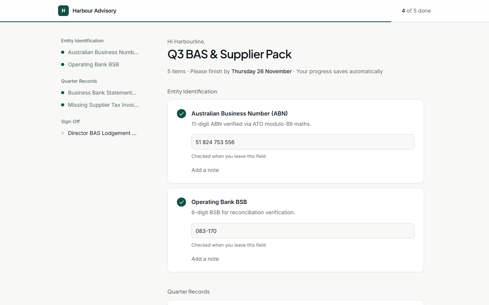

# GatherGate

**Stop chasing clients for documents. Collect files, validate structured details deterministically, and automate follow-ups in one self-hosted container.**

A lightweight MIT-licensed alternative to Content Snare and FileInvite built on Node.js, Hono, SQLite (WAL), React 19, `shadcn/ui`, and Tailwind CSS v4. Built by **[TensorForge](https://tensorforge.dev)**.

- **[Live Browser Demo (Operator Console)](https://faas19.github.io/gathergate/demo/#/)**
- **[Client Portal Demo](https://faas19.github.io/gathergate/demo/#/c/demo-bas)**
- **[Project Site](https://faas19.github.io/gathergate/)**


---

## 60-Second Quickstart (Docker)

Run the published multi-arch container image with zero `.env` setup required on first boot:

```bash
docker run -d --name gathergate -p 127.0.0.1:3080:3080 -v gathergate_data:/data ghcr.io/faas19/gathergate:latest
```

Or build and run from source with Docker Compose:

```bash
docker compose up -d --build
```

When `MASTER_KEY` is unset on first boot, GatherGate generates a 32-byte encryption key at `DATA_DIR/.master.key` and displays a persistent banner until you move `MASTER_KEY` into an environment variable (see [`.env.example`](.env.example)) for production.

Open `http://127.0.0.1:3080` to set up your workspace and optionally load three pre-populated sample requests.

---

## Product Tour

| Operator Document Review | Passwordless Client Portal |
| :---: | :---: |
|  |  |

---

## Why GatherGate

- **Passwordless magic links with optional 6-digit email OTP**: Clients upload documents and answer questions without creating accounts, and can leave notes or mark optional items as not applicable instead of reverting to email.
- **Deterministic validator packs and magic-byte sniffing**: Verify real file signatures (`PDF`, `PNG`, `JPEG`, `WebP`, `DOCX`, `XLSX`, `CSV`, `TXT`) and checksums on arrival so malformed submissions never reach your review queue.
- **Continuous keyboard-first review**: Step through uploaded files inside a decrypted inline preview drawer (`J`/`K` navigate, `Space` preview, `A` approve and advance, `R` request revision with one-click feedback chips).
- **AES-256-GCM vault with scheduled auto-purge**: Per-record HKDF keys derived from `MASTER_KEY` encrypt every file blob and sensitive field; completed packs shred automatically after your retention window (14 days by default for TFN/Medicare packs, 30 days otherwise).
- **Canonical ZIP export and signed webhooks**: Download consistently named packs (`{client}_{item}_{seq}.{ext}` plus `summary.json`) or receive HMAC-SHA256 `request.completed` webhooks into n8n or downstream workflows.
- **Built-in email and white-label branding**: Start immediately with the Local Email Outbox, then switch per workspace or via environment variables to SMTP or Resend with your firm logo, colours, and support details.

---

## Comparison

| Capability | GatherGate (Self-Hosted) | Content Snare | FileInvite |
| :--- | :--- | :--- | :--- |
| **Licence & Pricing** | MIT (free, unlimited requests) | Paid SaaS (per-seat / tiered) | Paid SaaS (tiered) |
| **Hosting & Data Residency** | Single Docker container + SQLite WAL (your infrastructure) | Vendor cloud | Vendor cloud |
| **Client Authentication** | Magic link + optional 6-digit email OTP | Magic link / PIN | Portal account / SMS / link |
| **Encryption at Rest** | AES-256-GCM with per-record HKDF keys | Vendor-managed | Vendor-managed |
| **Validation & File Checks** | Magic-byte inspection + deterministic validator packs | Field format rules | Basic field rules |
| **Operator Review Speed** | Continuous decrypted preview sheet + `J`/`K`/`A`/`R` triage | Item-by-item UI | Portal list view |
| **Automation & Webhooks** | Automated reminders, canonical ZIP export, HMAC-SHA256 webhooks | Zapier / Make / API | API / Zapier |

---

## Validator Packs

Validator packs live in `src/validators/packs/` and run deterministically before submissions enter your review queue (unknown validator keys fail closed):

- **Generic pack** (`src/validators/packs/generic.ts`): `email`, `url`, `phone_e164` (international E.164), and `iban` (ISO 13616 mod-97).
- **Australia pack** (`src/validators/packs/au.ts`): `au_abn_mod89` (ATO 11-digit ABN), `au_bsb` (6-digit BSB), `au_tfn_mod11` (ATO TFN, stored masked with audited reveal), `au_medicare_mod10` (Services Australia Medicare + IRN, stored masked), and `au_phone_e164` (`+61` normalisation).

Australia is the first country pack shipped out of the box. Adding UK (NINO/UTR), NZ (IRD), US (EIN), CA (SIN), or EU packs takes one small module implementing `ValidatorPack` (see [CONTRIBUTING.md](CONTRIBUTING.md)).

---

## Storage, Email & Tenancy

- **Storage (`STORAGE_BACKEND`)**: `local` (encrypted blobs in `DATA_DIR/blobs`, default) or `s3` (Cloudflare R2, AWS S3, MinIO, Backblaze B2 via SigV4).
- **Email (`EMAIL_BACKEND`)**: `console` (routes to Local Email Outbox and stdout, default), `smtp` (Nodemailer), or `resend` (Resend HTTP API). Per-workspace mail settings can also be encrypted and managed in `/settings`.
- **Tenancy (`MULTI_TENANT`)**: `false` for single-workspace self-hosting (unlimited requests and storage, default), or `true` for hosted multi-tenant mode with configurable free-tier limits (`FREE_MAX_ACTIVE_REQUESTS`, `FREE_MAX_STORAGE_BYTES`).

---

## Backup & Restore

GatherGate stores structured state in `DATA_DIR/gathergate.sqlite` and encrypted uploads in `DATA_DIR/blobs/`. Decryption depends on `MASTER_KEY` (keep `MASTER_KEY` in your password manager or secret store, separate from archive files).

### Backup

Stop the container so WAL frames are checkpointed cleanly before archiving:

```bash
docker compose stop gathergate
docker run --rm -v gathergate_gathergate_data:/data -v "$PWD:/backup" alpine \
  tar -czf "/backup/gathergate-backup-$(date +%F).tar.gz" -C /data gathergate.sqlite blobs
docker compose start gathergate
```

### Restore

Restore the archive into a fresh `/data` volume, provide the matching `MASTER_KEY` via `.env` or `-e MASTER_KEY=...`, then boot and verify an encrypted document preview or ZIP export:

```bash
docker volume create gathergate_gathergate_data
docker run --rm -v gathergate_gathergate_data:/data -v "$PWD:/backup" alpine \
  tar -xzf /backup/gathergate-backup-YYYY-MM-DD.tar.gz -C /data
docker compose up -d
```

---

## Local Development & Verification

Requires Node.js >= 22.13 (Node 24+ recommended for built-in `node:crypto.argon2Sync` and `node:sqlite`):

```bash
npm install
npm --prefix client install
npm run typecheck
npm run build
npm test
npm run test:e2e
npm start
```

For hot-reloading UI development, run `npm run dev` (API on `:3080`) and `npm run dev:client` (Vite dev server on `:5173` proxying `/api`).

To build and verify the static showcase site and in-browser `VITE_DEMO=1` demo locally under the `/gathergate/` subpath:

```bash
npm run build:pages
npm run test:pages
```

---

## Managed Cloud (Coming Soon)

Prefer zero server maintenance with Australian data residency? A managed GatherGate Cloud tier is planned next. Send early-access enquiries to **[contact@tensorforge.dev](mailto:contact@tensorforge.dev?subject=GatherGate%20Managed%20Cloud%20Enquiry)**.

---

## Contributing, Security & Changelog

- **Contributing & Validator Packs:** See [CONTRIBUTING.md](CONTRIBUTING.md).
- **Security & Threat Model:** See [SECURITY.md](SECURITY.md) (`zero telemetry` guarantee and responsible disclosure).
- **Release History:** See [CHANGELOG.md](CHANGELOG.md).

---

## MIT Licence

Released under the [MIT Licence](LICENSE). Built by **[TensorForge](https://tensorforge.dev)** ([`contact@tensorforge.dev`](mailto:contact@tensorforge.dev?subject=GatherGate%20Enquiry)).
